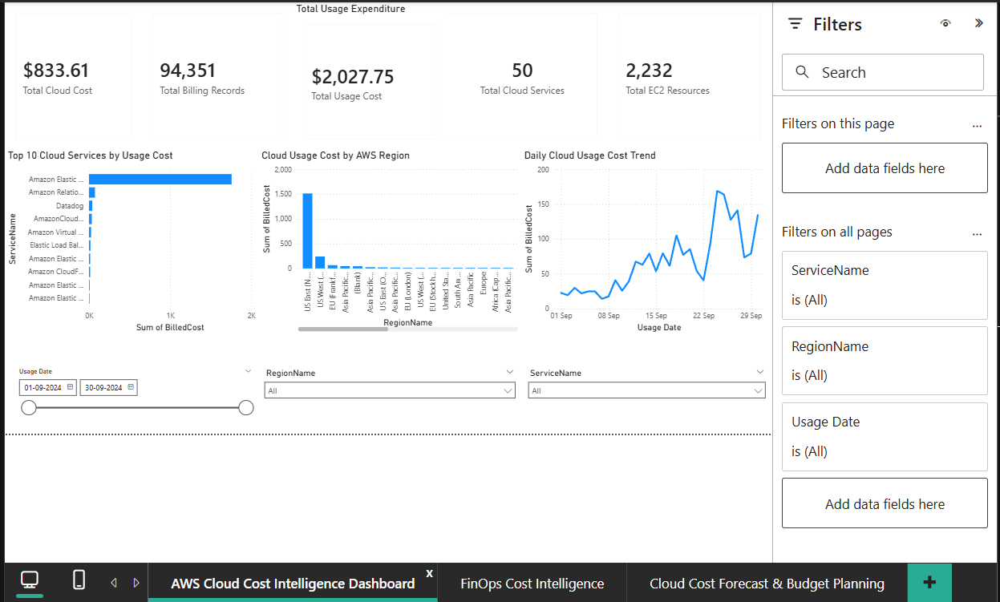
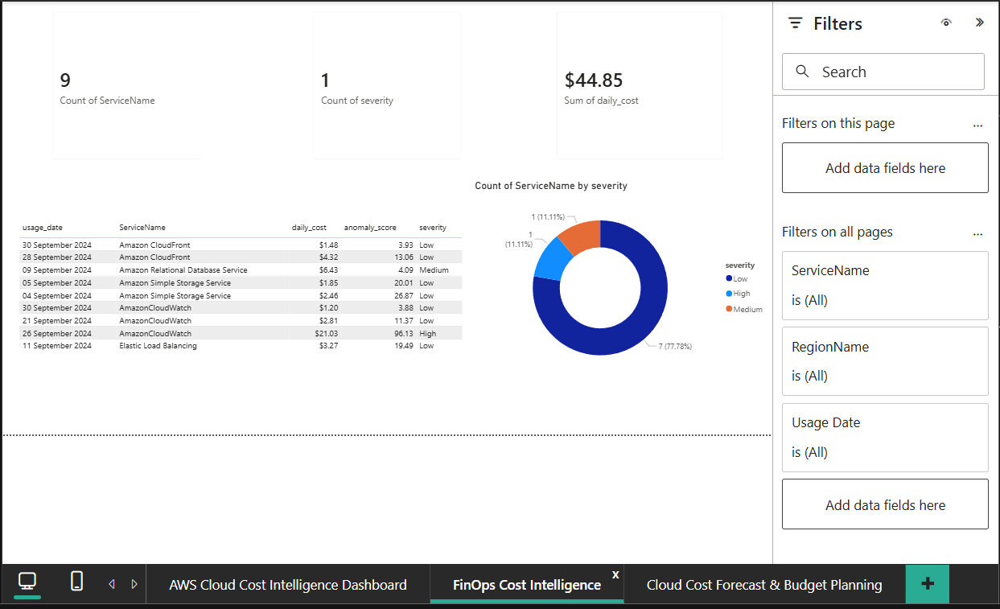
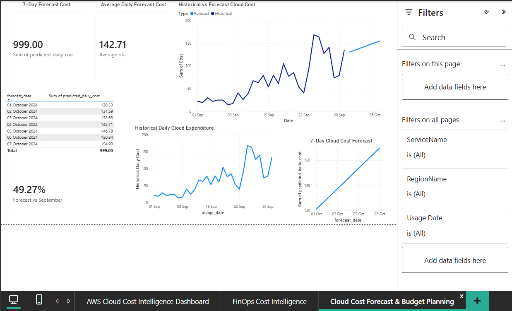

# AI-Powered Cloud Cost Intelligence

An end-to-end cloud cost analytics and FinOps project that analyzes AWS billing data, identifies unusual spending patterns, evaluates cost distribution, and forecasts future cloud expenditure.

## Project Overview

Cloud environments use multiple services and resources, making it difficult to understand spending patterns and identify unusual cost behaviour.

This project uses AWS billing data in the FinOps Open Cost and Usage Specification (FOCUS) format to build a cost intelligence solution using Python, PostgreSQL, SQL, and Power BI.

The solution provides visibility into cloud expenditure, service-wise costs, regional spending, statistical anomalies, and short-term cost forecasts.

## Objectives

- Analyze AWS cloud billing data.
- Identify data quality issues and spending patterns.
- Analyze costs by service, region, resource, and environment.
- Identify statistically unusual daily spending patterns.
- Forecast cloud expenditure for the next seven days.
- Present actionable cost insights through Power BI dashboards.

## Technology Stack

| Area | Tools |
|---|---|
| Programming | Python |
| Data Analysis | Pandas, NumPy |
| Machine Learning | Scikit-learn, Linear Regression |
| Database | PostgreSQL |
| Querying | SQL |
| Visualization | Power BI, Matplotlib |
| Development | VS Code, Git, GitHub |

## Project Architecture

1. **Data Source:** AWS FOCUS sample billing dataset.
2. **Data Processing:** Python and Pandas for filtering, cleaning, and analysis.
3. **Storage:** PostgreSQL for billing records and EC2 resource inventory.
4. **Analytics:** SQL queries and Python-based cost analysis.
5. **Anomaly Detection:** Statistical analysis of daily cloud expenditure.
6. **Forecasting:** Linear Regression compared against a seven-day moving-average baseline.
7. **Visualization:** Power BI dashboards for cost monitoring and FinOps insights.

## Dashboard Preview

### AWS Cloud Cost Intelligence


### FinOps Cost Intelligence


### Cloud Cost Forecast & Budget Planning



## Key Findings

- Processed 94,351 AWS billing records.
- Analyzed 50 cloud services.
- Examined 2,232 distinct EC2 resource IDs.
- Identified that approximately 67.5% of the EC2 resource IDs in the extracted dataset belonged to US East (N. Virginia).
- Found that approximately 33.14% of billing records had no tags.
- Observed that development-tagged expenditure was higher than production-tagged expenditure in the sample.
- Identified statistically significant spending anomalies for further investigation.

## Cost Forecasting

Two forecasting approaches were evaluated:

- Linear Regression
- Seven-Day Moving Average

| Evaluation Metric | Linear Regression | Moving Average |
|---|---:|---:|
| MAE | 33.59 | 39.33 |
| RMSE | 37.40 | 44.97 |

Linear Regression was selected because it performed better on the held-out test period.

The model generated a seven-day forecast of approximately **$999.00**, with an average predicted daily cost of approximately **$142.71**.

## Power BI Dashboards

### 1. AWS Cloud Cost Intelligence
- Total cloud cost and billing records
- Top 10 cloud services by usage cost
- Regional cost distribution
- Daily cloud usage cost trend
- Date, region, and service filters

### 2. FinOps Cost Intelligence
- Statistical anomaly summary
- Anomaly severity distribution
- Service-wise anomaly details
- Daily cost and anomaly scores

### 3. Cloud Cost Forecast & Budget Planning
- Seven-day forecast expenditure
- Average daily forecast
- Historical versus forecast comparison
- Forecast details by date

## Repository Structure

```text
AI-Powered-Cloud-Cost-Intelligence/
│
├── datasets/
│
├── docs/
│   ├── 01_Project_Overview.md
│   ├── 02_Dataset_Dictionary.md
│   ├── 03_Data_Quality_Report.md
│   ├── 04_EDA_Findings.md
│   ├── 05_SQL_Analysis.md
│   ├── 06_FinOps_Recommendations.md
│   ├── 07_EC2_Resource_Analysis.md
│   ├── 08_Anomaly_Detection_Findings.md
│   └── 09_Cost_Forecasting.md
│
├── notebooks/
│
├── outputs/
│
├── src/
│   ├── exploratory_analysis.py
│   ├── load_billing_data.py
│   ├── test_db_connection.py
│   └── cost_forecasting.py
│
├── .env
├── .gitignore
└── README.md
```

## Business Recommendations

- Improve resource tagging coverage to strengthen cost allocation.
- Review development environment spending and investigate opportunities to schedule non-production resources.
- Monitor services and regions contributing the highest expenditure.
- Investigate unusual cost movements before taking optimization action.
- Use cost forecasts as planning estimates and compare them against actual expenditure.

## Limitations

- The project uses sample billing data rather than a live AWS account.
- Forecasts are based on a limited historical period and should not be treated as guaranteed future expenditure.
- Statistical anomalies indicate unusual patterns, not confirmed incidents or billing errors.
- Actual idle-resource identification requires independent resource inventory and utilization metrics, such as CloudWatch data.

## Future Enhancements

- Integrate live AWS Cost and Usage Reports.
- Incorporate CloudWatch utilization metrics.
- Develop automated cost anomaly alerts.
- Add budget thresholds and actual-versus-forecast monitoring.
- Explore more advanced time-series forecasting methods.

## Conclusion

This project demonstrates an end-to-end FinOps analytics workflow, combining billing-data analysis, SQL, statistical anomaly detection, cost forecasting, and business intelligence visualization to support cloud cost visibility and informed optimization decisions.